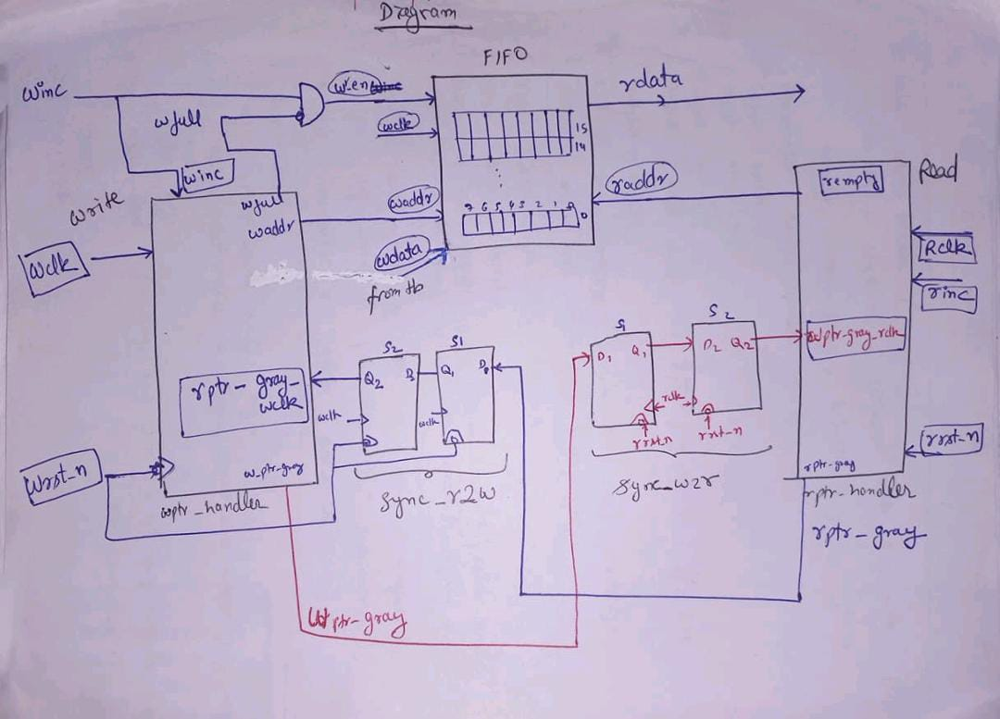

# Asynchronous (Dual-Clock) FIFO — Verilog

A parameterized asynchronous FIFO written in Verilog, using the classic
Gray-code pointer technique (Clifford E. Cummings, SNUG 2002 — *"Simulation
and Synthesis Techniques for Asynchronous FIFO Design"*) for safely crossing
independent write and read clock domains.

The design separates pointer/flag generation, clock-domain synchronization,
and storage into distinct modules so each piece can be reasoned about (and
verified) independently.

## Repository Contents

| File | Modules | Purpose |
|---|---|---|
| `pointer_handler.v` | `wptr_handler`, `rptr_handler` | Binary→Gray pointer generation, memory addressing, and `full` / `empty` flag logic |
| `syncronisers_and_memory.v` | `fifo_memory`, `sync_r2w`, `sync_w2r` | Dual-port storage array and 2-flip-flop Gray-code synchronizers |
| `Testb.v` | `Testb` | Testbench that instantiates and wires up all five modules above and exercises fill, drain, and concurrent read/write scenarios |

> There is no separate `fifo_top` wrapper module — `Testb.v` itself performs
> the module-to-module wiring (see [Integration](#integration)), so it
> doubles as the reference for how to instantiate the design.

## Architecture

Write and read pointers are kept in Gray code before crossing clock domains
so that only one bit ever changes per pointer increment — this guarantees
metastability-safe synchronization through the 2-flop synchronizers.

## Module Reference

### `wptr_handler` (in `pointer_handler.v`)
Tracks the binary write pointer, converts it to Gray code, drives the write
address, and generates the `full` flag.

| Port | Dir | Width | Description |
|---|---|---|---|
| `wclk` | in | 1 | Write-domain clock |
| `wrst_n` | in | 1 | Active-low async reset |
| `winc` | in | 1 | Write request |
| `rptr_gray_wclk` | in | `ADDR_WIDTH+1` | Read pointer, Gray-coded, synchronized into `wclk` domain |
| `waddr` | out | `ADDR_WIDTH` | Address driven to `fifo_memory` for writes |
| `wptr_gray` | out (reg) | `ADDR_WIDTH+1` | Gray-coded write pointer, sent to read domain |
| `wfull` | out (reg) | 1 | FIFO full flag |

- Parameter: `ADDR_WIDTH` (default `4` → 16-entry FIFO).
- `full` is asserted using the standard Cummings comparison: the next Gray
  write pointer equals the synchronized Gray read pointer with its two MSBs
  inverted. A special case is handled for `ADDR_WIDTH == 1`, where the
  pointer is only 2 bits wide and both bits are the "MSBs" being compared.

### `rptr_handler` (in `pointer_handler.v`)
Mirror of `wptr_handler` for the read side: tracks the binary read pointer,
converts it to Gray code, drives the read address, and generates the
`empty` flag.

| Port | Dir | Width | Description |
|---|---|---|---|
| `rclk` | in | 1 | Read-domain clock |
| `rrst_n` | in | 1 | Active-low async reset |
| `rinc` | in | 1 | Read request |
| `wptr_gray_rclk` | in | `ADDR_WIDTH+1` | Write pointer, Gray-coded, synchronized into `rclk` domain |
| `raddr` | out | `ADDR_WIDTH` | Address driven to `fifo_memory` for reads |
| `rptr_gray` | out (reg) | `ADDR_WIDTH+1` | Gray-coded read pointer, sent to write domain |
| `rempty` | out (reg) | 1 | FIFO empty flag |

- `empty` is asserted when the next Gray read pointer exactly equals the
  synchronized Gray write pointer.
- `rempty` resets to `1` (FIFO starts empty), matching `wfull` resetting to `0`.

### `fifo_memory` (in `syncronisers_and_memory.v`)
Simple dual-port storage array: synchronous write on `wclk`, combinational
(asynchronous) read.

| Port | Dir | Width | Description |
|---|---|---|---|
| `wclk` | in | 1 | Write clock |
| `wr_en` | in | 1 | Write enable (typically `winc & ~wfull`) |
| `waddr` | in | `ADDR_WIDTH` | Write address |
| `wdata` | in | `DATA_WIDTH` | Write data |
| `raddr` | in | `ADDR_WIDTH` | Read address |
| `rdata` | out | `DATA_WIDTH` | Read data (combinational) |

- Parameters: `DATA_WIDTH` (default `8`), `ADDR_WIDTH` (default `4` → depth
  of `2^4 = 16` entries).

### `sync_r2w` (in `syncronisers_and_memory.v`)
Two-stage flip-flop synchronizer that brings the Gray-coded **read** pointer
into the **write** clock domain.

| Port | Dir | Width | Description |
|---|---|---|---|
| `wclk` | in | 1 | Destination (write) clock |
| `wrst_n` | in | 1 | Active-low async reset |
| `rptr_gray` | in | `PTR_WIDTH` | Gray read pointer, source (read) domain |
| `rptr_gray_wclk` | out (reg) | `PTR_WIDTH` | Gray read pointer, synchronized into write domain |

### `sync_w2r` (in `syncronisers_and_memory.v`)
Two-stage flip-flop synchronizer that brings the Gray-coded **write** pointer
into the **read** clock domain. Same structure as `sync_r2w`, mirrored for
the opposite direction.

| Port | Dir | Width | Description |
|---|---|---|---|
| `rclk` | in | 1 | Destination (read) clock |
| `rrst_n` | in | 1 | Active-low async reset |
| `wptr_gray` | in | `PTR_WIDTH` | Gray write pointer, source (write) domain |
| `wptr_gray_rclk` | out (reg) | `PTR_WIDTH` | Gray write pointer, synchronized into read domain |

- Both synchronizers share parameter `PTR_WIDTH` (default `5`), which should
  be set to `ADDR_WIDTH + 1` to match the pointer modules.

## Integration

`Testb.v` wires the five modules together like this (instance names as used
in the testbench):

| Instance | Module | Connections |
|---|---|---|
| `Write` | `wptr_handler` | drives `waddr`, `wptr_gray`, `wfull` |
| `Read` | `rptr_handler` | drives `raddr`, `rptr_gray`, `rempty` |
| `Sync_R2W` | `sync_r2w` | takes `Read.rptr_gray`, outputs `rptr_gray_wclk` into `Write` |
| `Sync_W2R` | `sync_w2r` | takes `Write.wptr_gray`, outputs `wptr_gray_rclk` into `Read` |
| `Mem` | `fifo_memory` | takes `Write.waddr` / `Read.raddr`, `wr_en = winc & ~wfull`, `wdata` |

Signal flow:

1. `Write.wptr_gray` → `Sync_W2R.wptr_gray` → `Sync_W2R.wptr_gray_rclk` → `Read.wptr_gray_rclk`
2. `Read.rptr_gray` → `Sync_R2W.rptr_gray` → `Sync_R2W.rptr_gray_wclk` → `Write.rptr_gray_wclk`
3. `Write.waddr` / `Read.raddr` → `Mem.waddr` / `Mem.raddr`
4. `Mem.wr_en` = `winc & ~wfull`
5. All `ADDR_WIDTH` / `PTR_WIDTH` parameters are kept consistent
   (`PTR_WIDTH = ADDR_WIDTH + 1`, both `4`/`5` by default) across instances.

## Testbench (`Testb.v`)

`Testb.v` instantiates the full design (see [Integration](#integration))
and drives it with two independent, unrelated clocks to genuinely exercise
the asynchronous clock-domain crossing:

- **`wclk`**: toggles every 5 ns (10 ns period)
- **`rclk`**: toggles every 21 ns (42 ns period)

Test sequence:

1. **Reset** — `wrst_n` / `rrst_n` are deasserted on the first `negedge` of
   their respective clocks.
2. **Fill test** — 20 back-to-back writes (`winc = 1`, `wdata` incrementing
   by 1 each cycle) into a 16-entry FIFO (`ADDR_WIDTH = 4`), to drive the
   FIFO into the `wfull` state and confirm writes stop landing once full
   (`wr_en = winc & ~wfull`).
3. **Drain test** — 20 back-to-back reads (`rinc = 1`) to drive the FIFO
   into the `rempty` state.
4. **Concurrent read/write test** — using `fork`/`join`, 50 writes
   (`wdata` incrementing by 2) and 50 reads run *simultaneously* on their
   respective clocks, exercising the synchronizers and full/empty logic
   under real concurrent traffic.
5. Waveforms are dumped to `Testb.vcd` (`$dumpfile` / `$dumpvars`) for
   visual inspection — the testbench does not currently include
   self-checking `$display`/assertion-based pass/fail output, so results
   should be verified by viewing the waveform.

## Simulation

## Simulation (AMD Xilinx Vivado)

You can run this simulation using Vivado:

### Using Vivado:
1. Create a new RTL project in Vivado.
2. Add the source files (`pointer_handler.v`, `syncronisers_and_memory.v`, `async_fifo.v`) and the testbench (`Testb.v`).
3. Set `Testb` as the top module for simulation.
4. Under the Flow Navigator, click **Run Simulation** -> **Run Behavioral Simulation**.

### Signals worth watching in the Vivado waveform viewer:
`wfull`, `rempty`, `wptr_gray`, `rptr_gray`, `rptr_gray_wclk`, `wptr_gray_rclk`, `wdata`, `rdata`.
